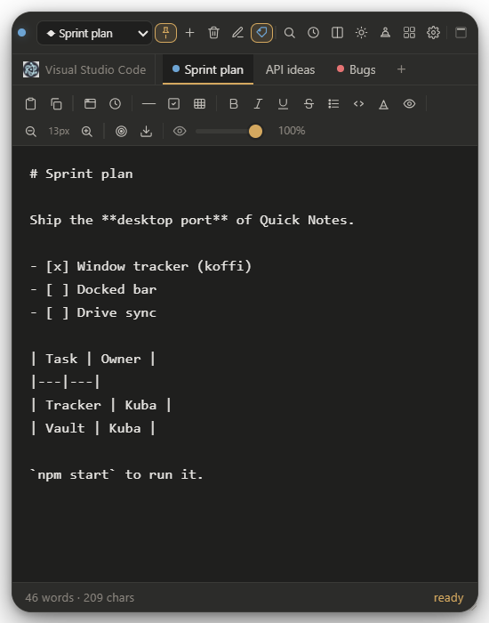
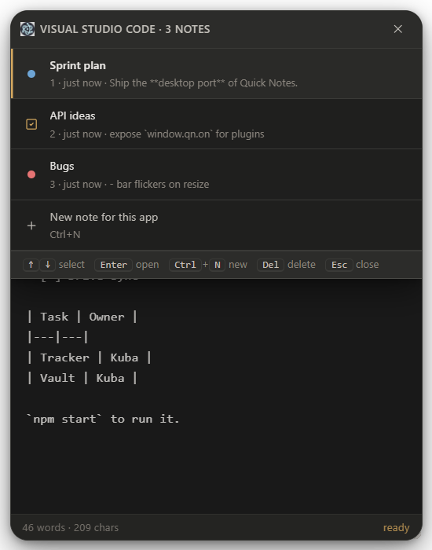
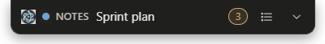
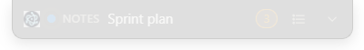
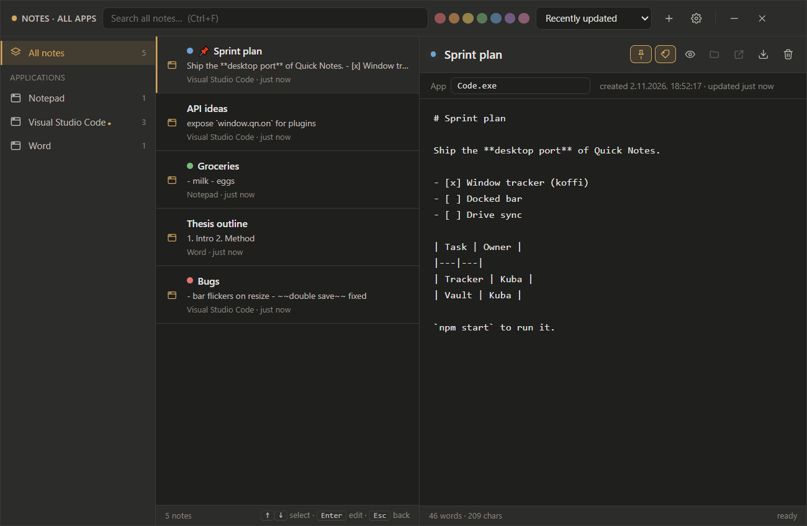

# Quick Notes Desktop

A standalone Windows app that ports the [Quick Notes](https://github.com/quicknotes/quick-notes) Chrome extension to the desktop. It keeps the same look, Markdown editor, and note stacking, but notes are pinned to **Windows applications** (by `.exe` process name) instead of URLs. Every note is also saved as a Markdown file to a local (Obsidian) vault folder and, optionally, to a Google Drive folder.

**Inspiracja i założenia (PL):** [PROJEKT.md](PROJEKT.md) · **Rozszerzenie Chrome (fork):** [better-quick-notes](https://github.com/Sliskislimak/better-quick-notes)

| Expanded note | App notes menu | Docked bar (awake / idle) |
|---|---|---|
|  |  | <br> |



## Requirements

- Windows 10 or 11 (x64)
- Node.js **22.12+** (or current 22 LTS), npm 10+

This repo targets **Electron 40+** (see `package.json`). Older Node 20 cannot install recent Electron packages; use Node 22 as installed via `winget install OpenJS.NodeJS.22`.

## Install and run

```powershell
cd desktop
npm install
npm start          # runs in the system tray
npm run dev        # same, plus DevTools for the note panel and renderer logs in the terminal
```

The app lives in the system tray. Right-click the tray icon for **Global notes menu**, **Settings…**, **Pause note tracking**, **Open vault folder**, and **Quit**. Left-click opens the dashboard.

## How it works

Focus any application and press **Alt+Shift+Q**. A sticky note opens and is pinned to that app's executable (for example `Code.exe`). From then on:

- **Expanded**: the full Quick Notes panel (toolbar, Markdown preview, split view, search, history, color tags, tables, images). Notes bound to the same app are stacked as tabs under the header.
- **Docked**: when you collapse the note (Alt+Shift+Q again, the dock button, or Esc), it becomes a slim bar hanging from the app's top edge. Click it to expand, drag it sideways to reposition it, and scroll over it to cycle through the stack.
- **Frosted / idle**: after a few seconds the bar fades to the idle opacity (25% by default) and returns to full opacity on hover or when a hotkey wakes it.
- **Tray daemon**: when you switch to an app that has notes, its bar appears automatically and follows the window when it moves or resizes. It hides when the app is minimized or loses focus.

Panel position and size are remembered per app, relative to the window edge, so the note rides along with the window. **Alt+Shift+R** re-centers it.

## Hotkeys

Global hotkeys work system-wide:

| Hotkey | Action |
|---|---|
| `Alt+Shift+Q` | Expand and focus the note for the current app (a note is created if none exists). Press again to collapse it to the bar and return focus to the app. |
| `Alt+Shift+W` | Open the current app's notes menu. Use ↑/↓, Enter, Ctrl+N (new), Del, 1–9, and Esc. |
| `Alt+Shift+A` | Open the global dashboard with all notes across all apps (search, app/tag filters, sort, inline editing). |

Inside a note:

| Hotkey | Action |
|---|---|
| `Ctrl+B` / `Ctrl+I` / `Ctrl+U` | Bold / italic / underline (toggles the markers around the selection) |
| `Ctrl+Shift+X` | Strikethrough |
| `Ctrl+Shift+L` | Bullet list (toggles on the selected lines) |
| `Ctrl+N`, `Ctrl+Tab` | New note in this app's stack, next note in the stack |
| `Ctrl+F`, `Ctrl+E`, `Ctrl+S` | Search, Markdown preview, save now |
| `F2` | Rename note |
| `Alt+Shift+S`, `Alt+Shift+R` | Split view, re-center the panel |
| `Esc` | Close the open menu or view, then collapse to the bar |
| `Alt`+drag | Move the panel from anywhere |

### Changing hotkeys

Open **Settings → Hotkeys**, click a hotkey, and press the new combination. Esc cancels and Backspace disables the hotkey. Global hotkeys are paused while you record, and each one reports **Active**, **already used by another application**, or a duplicate conflict.

Hotkeys are stored in `%APPDATA%\Quick Notes Desktop\state.json` under `settings.hotkeys` and use [Electron accelerator](https://www.electronjs.org/docs/latest/api/accelerator) syntax (for example `Ctrl+Alt+N`, `Super+Shift+K`, `F8`). If you edit the file by hand, quit the app first.

## Storage

The app keeps its own copy of all notes in `%APPDATA%\Quick Notes Desktop\state.json`, written atomically, so it works without a vault.

### Local vault (Obsidian)

In **Settings → Local vault folder**, choose a folder (for example your Obsidian vault or a subfolder of it). Each note is written to `${sanitizedTitle}_${noteId.slice(0, 6)}.md`, with `< > : " / \ | ? *` in the title replaced by hyphens:

```markdown
---
title: "Sprint plan"
app_name: "Visual Studio Code"
process: "Code.exe"
created: "2026-11-02T17:51:05.422Z"
updated: "2026-11-02T17:53:40.118Z"
tags:
  - quicknotes
  - desktop-app
---
# Sprint plan
...
```

- The folder is watched with chokidar, so edits you make in Obsidian appear in the open note live. Extra frontmatter keys and tags you add in Obsidian are preserved.
- Renaming a note renames its file, keeping the id suffix. Deleting a note moves its file to the Recycle Bin.
- `.md` files with `process:` frontmatter or the `quicknotes` tag that are dropped into the folder are imported.
- Pasted or dropped images go to `attachments/` in the vault and are linked as ``.

### Google Drive

1. In [Google Cloud Console → Credentials](https://console.cloud.google.com/apis/credentials), create a project and enable the **Google Drive API**.
2. Configure the OAuth consent screen (External; add yourself as a test user).
3. Create an **OAuth client ID** with application type **Desktop app**.
4. In **Settings → Google Drive sync**, paste the client ID and client secret, then pick the access level:
   - **Full Drive** (`drive` scope) works with any existing folder ID.
   - **drive.file** only reaches files and folders this app created. Use **Create a Quick Notes folder**.
5. Paste the folder ID (the last part of the folder's URL) or create a folder, then click **Test connection**.
6. Click **Sign in with Google**. The browser opens, and after you approve, Google redirects back to the app on `127.0.0.1` (loopback flow with PKCE).

Files are uploaded with `mimeType: text/markdown` and `parents: [folderId]`. Later saves `PATCH` the same file ID, so there are no duplicates, and deleting a note moves its Drive file to the Drive trash. **Pull** imports notes edited or added in that folder, and you can set it to run on an interval. The client secret and refresh token are encrypted with Windows DPAPI (Electron `safeStorage`) in `drive-secrets.bin`; they are never written to `state.json`.

### Backups

**Settings → Backup & restore** exports everything to one JSON file. It also imports backups from the Chrome extension.

## Build

```powershell
npm run build       # dist\Quick Notes Desktop Setup 1.0.0.exe (NSIS installer) + portable .exe
npm run build:dir   # dist\win-unpacked\ only, quicker for testing
```

`koffi` (the native FFI library used for window tracking) is unpacked from the asar automatically. The installer build isn't code-signed, so SmartScreen will warn on first run. **Start Quick Notes when I sign in** only applies to the installed build; it starts hidden in the tray.

## Development

```powershell
npm test                # unit tests: frontmatter format, file names, note store
npm run snapshots       # renders every window invisibly to .snapshots\*.png and checks the vault round trip
npm run smoke:tracker   # logs live foreground / move / title events for 10 s (QN_SMOKE_MS to change)
npx electron scripts/make-icons.js   # regenerates assets\ from ..\icons\
```

`--user-data=<dir>` runs the app with a separate data folder, alongside your normal instance.

```
desktop/
  main.js                    tray, windows, IPC, store fan-out to vault and Drive
  preload.js                 whitelisted window.qn.invoke / window.qn.on bridge
  services/
    windowTracker.js         Win32 via koffi: foreground HWND, process, bounds, WinEvent hooks + polling
    overlayManager.js        docked bar and expanded panel windows, docking geometry, drag/resize
    shortcutManager.js       global hotkeys with conflict reporting
    noteStore.js             notes, prefs, settings (state.json)
    frontmatter.js           YAML frontmatter build/parse, file naming
    storageVault.js          vault writes, renames, chokidar watcher, attachments
    driveSync.js             OAuth loopback + PKCE, multipart POST/PATCH, pull
  renderer/
    shared/                  theme tokens, icons, Markdown renderer (ported from content.js)
    panel/                   the expanded sticky note
    bar/                     the docked bar
    dashboard/               the global notes dashboard
    settings/                settings (ported from options.html)
```

## Known limitations

- **Frosted blur**: Windows doesn't let a transparent Electron window blur other apps' pixels behind it, so the idle bar is mostly translucent rather than truly blurred.
- **Elevated apps**: when the focused app runs as administrator, the overlay still docks to it, but Windows may refuse to hand focus back to it after collapsing. Run Quick Notes elevated if you need that.
- **UWP / Store apps** (Calculator, Settings, Photos…) are resolved to their real executable through the window's CoreWindow. Suspended frames can fall back to `ApplicationFrameHost.exe`.
- **Exclusive fullscreen games** draw above always-on-top windows. Add them under **Settings → Behavior → Ignored applications**.
- `Alt+Shift` alone switches keyboard layouts on many systems. The default hotkeys add a letter, so they don't interfere, but avoid binding plain `Alt+Shift`.
